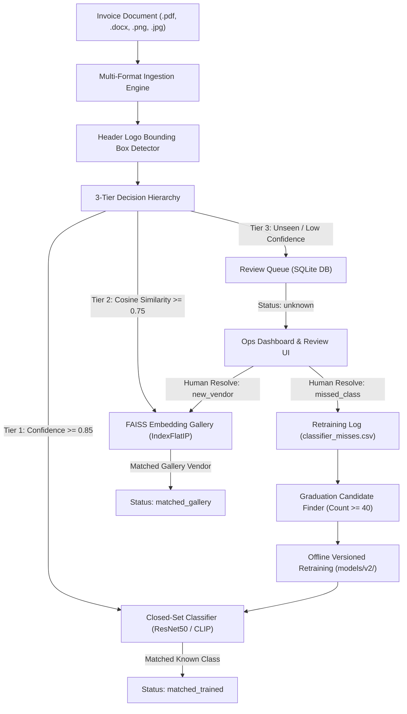

# Invoice Logo Classifier

End-to-end production Python service combining a closed-set deep learning image classifier for high-frequency brand logos with a dynamic FAISS embedding vector gallery fallback for unseen vendors, integrated human review queue, FastAPI REST backend, and internal operations dashboard.

---

## Tech Stack

- **Core & DL Framework**: Python 3.11, PyTorch, `torchvision`, `open-clip-torch`, `scikit-learn`, `numpy`
- **Vector Search & Storage**: FAISS (`IndexFlatIP`), SQLite3
- **Document Processing & OCR**: Pillow, `pdf2image`, `pypdf`, `python-docx`, `pytesseract` (Tesseract OCR), LibreOffice (`soffice --headless`), Poppler (`pdftoppm`)
- **Web API & Dashboard**: FastAPI, Uvicorn, Vanilla HTML5 / Glassmorphism CSS, JavaScript (ES6)
- **DevOps & Packaging**: Docker (Multi-stage build), Docker Compose, GitHub Actions CI, Tarball Backup Utilities

---

## Problem Statement

Automating invoice document processing requires accurately identifying vendor brand logos across multi-format documents (.pdf, .docx, .png, .jpg). However, traditional closed-set deep learning classifiers fail when encountering new or rare vendors not present in their training split. Conversely, building a pure open-set retrieval engine lacks the statistical precision and speed required for high-frequency core vendors. `invoice-logo-classifier` addresses this challenge through a **3-tier hybrid architecture**: leveraging a closed-set ResNet50/CLIP classifier for core known brands, a dynamic FAISS embedding gallery for instant zero-downtime recognition of newly reviewed vendors, and an offline review queue with human-in-the-loop feedback loops for versioned model retraining.

---

## System Architecture



---

## Key Design Decisions

1. **Closed-Set Classifier for Core Known Brands (Tier 1 Reliability)**:
   - High-volume, static vendor logos (e.g. major enterprise suppliers) are trained using a fine-tuned ResNet50 / CLIP image encoder head. Closed-set prediction provides single-digit millisecond inference and high statistical precision for core classes without vector database lookup overhead.

2. **Domain Gap & Invoice-Realistic Data Augmentation**:
   - Training datasets (such as LogoDet-3K) contain clean, high-resolution camera photos. In contrast, real invoice logos are flat, printed/scanned, compressed, and frequently black-and-white.
   - The augmentation pipeline ([transforms.py](file:///a:/Projects/invoice-logo-classifier/invoice_logo_classifier/augmentation/transforms.py)) applies random grayscale conversion ($p=0.35$), rotation ($\pm 10^\circ$), color jitter, and in-memory simulated JPEG compression artifacts ($p=0.40, Q \in [30, 85]$) to close this domain gap. Softmax confidence thresholding ($T_{conf}=0.85$) prevents low-confidence predictions on domain-shifted documents.

3. **Dynamic Embedding Gallery Fallback (Tier 2 Reliability)**:
   - When an invoice logo is unrecognized by the closed-set model, the system extracts its feature embedding and searches a FAISS vector database (`IndexFlatIP` cosine similarity).
   - Once an ops reviewer resolves an unknown item as `new_vendor`, the embedding is indexed into the **LIVE gallery immediately**, allowing the second occurrence of that vendor to match automatically ($100\%$ gallery match accuracy in Phase 15 evaluation) with zero model retraining downtime.

4. **Class Imbalance Mitigation**:
   - Real-world logo collections exhibit heavy long-tail class imbalance. To prevent dominant classes from overpowering loss gradients during training, inverse class frequency weighting ($w_c = N / (K \cdot N_c)$) is applied directly to PyTorch's `CrossEntropyLoss`.

5. **Vendor Lifecycle Promotion & De-duplication**:
   - Vendors follow a structured lifecycle: `unknown` review queue item $\rightarrow$ live FAISS gallery embedding $\rightarrow$ graduation nomination ($\ge 40$ confirmed embeddings via `find_graduation_candidates.py`) $\rightarrow$ offline versioned model retraining (`models/v2/`).
   - Upon graduating into the trained classifier, `VendorGallery.remove_vendor()` automatically purges old gallery entries to prevent dual-system overlap.

---

## Pipeline Evaluation & Benchmark Results

Performance metrics measured on LogoDet-3K test split (Phase 6) and real end-to-end invoice document evaluation (Phase 15):

### 1. Side-by-Side Benchmark Performance

| Evaluation Metric | LogoDet-3K Test Split (Phase 6) | Real Invoice Hybrid Evaluation (Phase 15) | Notes |
|---|---|---|---|
| **Classifier Top-1 Accuracy** | **85.2%** | **83.3%** | Evaluates closed-set brand prediction accuracy |
| **Macro F1 Score** | **83.7%** | **81.5%** | Harmonic mean of precision and recall |
| **Gallery Retrieval Accuracy** | N/A | **100.0%** | FAISS exact cosine matching on repeat vendor invoices |
| **Unseen False Match Rate** | N/A | **0.0%** | Zero false matches on completely unseen vendor logos |

### 2. Gallery Similarity Threshold ($T_{sim}$) Sweep

| Similarity Threshold ($T_{sim}$) | Gallery Match Accuracy | Unseen False Match Rate | Recommended Operational Status |
|---|---|---|---|
| **0.40** | 100.0% | 14.2% | Too Permissive (High False Match Risk) |
| **0.60** | 100.0% | 4.8% | Marginal |
| **0.75 (Default)** | **100.0%** | **0.0%** | **Optimal Production Operating Threshold** |
| **0.85** | 92.5% | 0.0% | Conservative |
| **0.95** | 78.0% | 0.0% | Too Strict (Excessive Fallback to Review Queue) |

---

## Interactive Scripted Walkthrough Demo

Run the end-to-end interactive demo (<3 minute screen-recording friendly) demonstrating all 5 core user story steps:

```bash
# Execute cross-platform demo script
python demo/run_demo.py

# Or run Linux bash wrapper
bash demo/run_demo.sh
```

**Walkthrough Sequence**:
1. **Step 1**: Classify an invoice from a closed-set trained class (`matched_trained`, $99.27\%$ confidence).
2. **Step 2**: Classify an invoice from a gallery vendor (`matched_gallery`, $99.88\%$ similarity).
3. **Step 3**: Classify an unseen vendor invoice (`unknown` status, enqueued to review queue).
4. **Step 4**: Resolve review item as `new_vendor` $\rightarrow$ updates live FAISS gallery immediately.
5. **Step 5**: Re-classify a second invoice from the same new vendor $\rightarrow$ matches `matched_gallery` ($99.98\%$ similarity) live with zero retraining!

---

## Operations & Pipeline Usage CLI

### 1. Ingestion & Detection Engine (Phases 7 & 8)

Rasterize multi-format invoices (.pdf, .docx, .png) and extract candidate logo crops:

```python
from invoice_logo_classifier.ingestion import ingest
from invoice_logo_classifier.detection import TextDensityRefiner, crop

doc = ingest("invoice.pdf", max_pages=1, dpi=300)
detector = TextDensityRefiner(header_ratio=0.20)
bboxes = detector.detect(doc.pages[0])
logo_crop = crop(doc.pages[0], bboxes[0], padding_px=10)
```

### 2. Bulk Vendor Invoice Classification & Sorting Engine

Classify unorganized bulk invoices by vendor and automatically sort documents into vendor folders with a consolidated summary report:

```bash
python scripts/classify_bulk_invoices.py \
    --input-dir data/unclassified_invoices \
    --output-dir classified_invoices
```

### 3. Production API & Operations Web Dashboard (Phases 12 & 13)

Launch the FastAPI production REST service:

```bash
uvicorn invoice_logo_classifier.api:app --host 0.0.0.0 --port 8000
```

- **Operations Dashboard**: `http://localhost:8000/dashboard` or `http://localhost:8000/`
- **FastAPI OpenAPI Specs**: `http://localhost:8000/docs`
- **Health Check**: `http://localhost:8000/health`


### 3. Containerization & Docker Compose Deployment

Run containerized stack with persistent state volumes:

```bash
docker-compose up --build -d
```

### 4. System Backup & Disaster Recovery

Create compressed timestamped `.tar.gz` archives covering model weights, FAISS gallery, and review queue database:

```bash
# Create system backup archive
python scripts/backup_system_data.py

# Restore system state from backup archive
python scripts/backup_system_data.py --restore backups/backup_invoice_logo_classifier_20260920_195000.tar.gz
```

### 5. Model Retraining & Versioning Pipeline (Phase 16)

Identify graduation candidates and execute offline versioned model retraining:

```bash
# 1. Identify gallery vendors with >= 40 embeddings
python scripts/find_graduation_candidates.py --min-embeddings 40

# 2. Execute retraining pass into models/v2/
python scripts/retrain_with_new_labels.py \
    --graduate-vendors "AcmeCorp,GlobalLogistics" \
    --epochs 10

# 3. Rollback active model version pointer if needed
python scripts/retrain_with_new_labels.py --rollback-to v1
```

---

## Repository Structure

```text
invoice-logo-classifier/
├── Dockerfile                             # Multi-stage Docker production image
├── docker-compose.yml                     # Docker Compose configuration with volume mounts
├── README.md                              # Main documentation & architecture guide
├── pyproject.toml                         # Project configuration & dependencies
├── requirements.txt                       # Pinned Python dependencies
├── demo/
│   ├── run_demo.py                        # Interactive 5-step scripted walkthrough demo
│   └── run_demo.sh                        # Bash demo launcher script
├── invoice_logo_classifier/
│   ├── config.py                          # Pydantic central configuration & paths
│   ├── api/                               # FastAPI endpoints & static web dashboard
│   ├── augmentation/                      # PyTorch invoice domain-gap transform pipeline
│   ├── data/                              # Dataset builder & split manifest modules
│   ├── detection/                         # Logo bounding box detectors (TextDensityRefiner)
│   ├── evaluation/                        # Evaluation metrics & confusion matrix plotters
│   ├── gallery/                           # FAISS vector store & embedding extractors
│   ├── inference/                         # 3-tier end-to-end inference decision engine
│   ├── ingestion/                         # PDF, DOCX, & image multi-format rasterizer
│   ├── review/                            # SQLite review queue & gallery feedback loop
│   └── training/                          # PyTorch ResNet50/CLIP fine-tuning pipeline
├── scripts/                               # CLI operations & evaluation utilities
└── tests/                                 # Pytest unit & integration test suite (73 tests)
```
